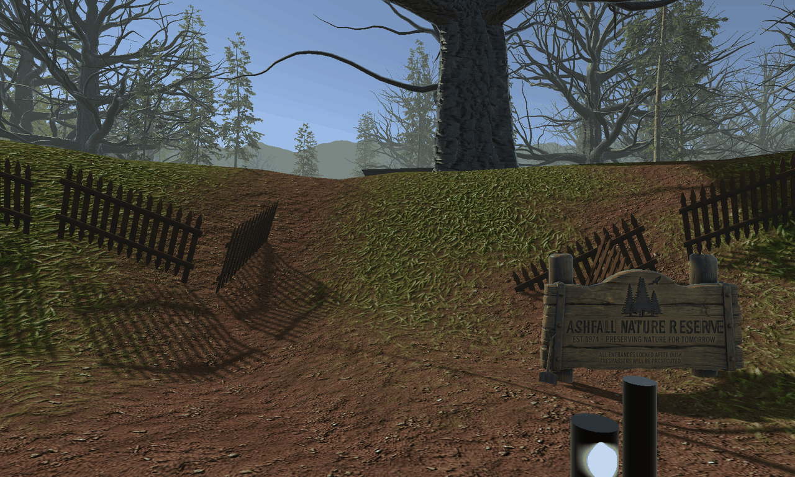
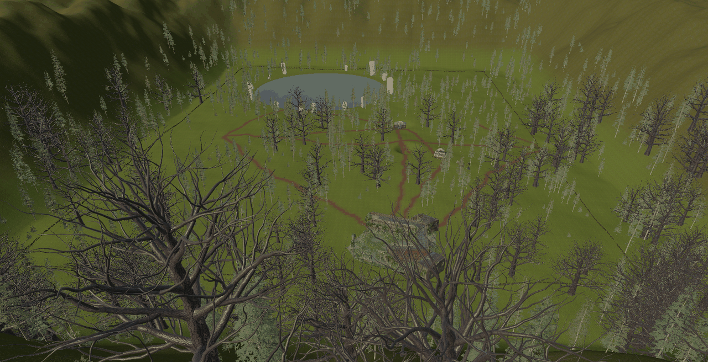
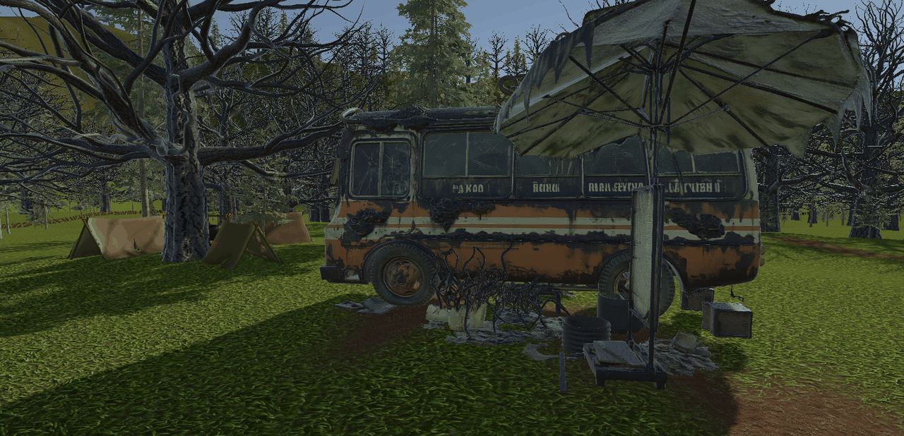
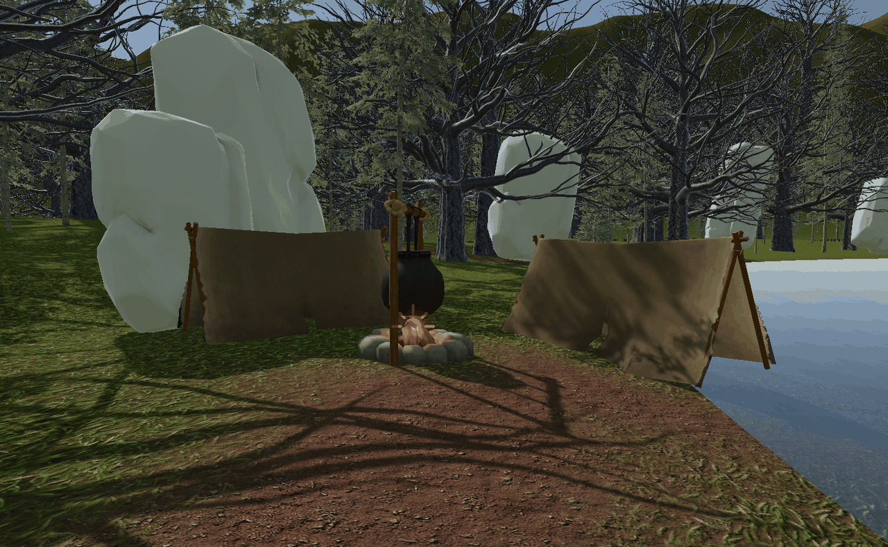
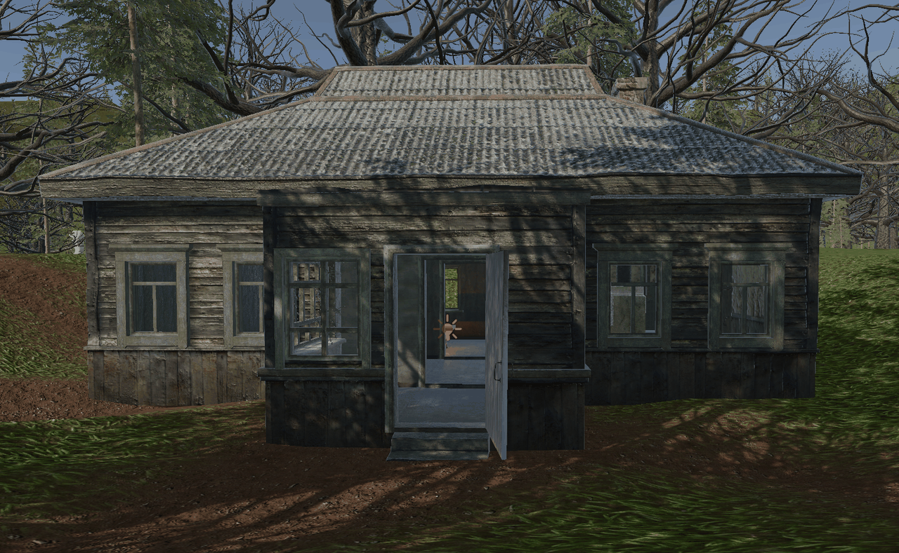
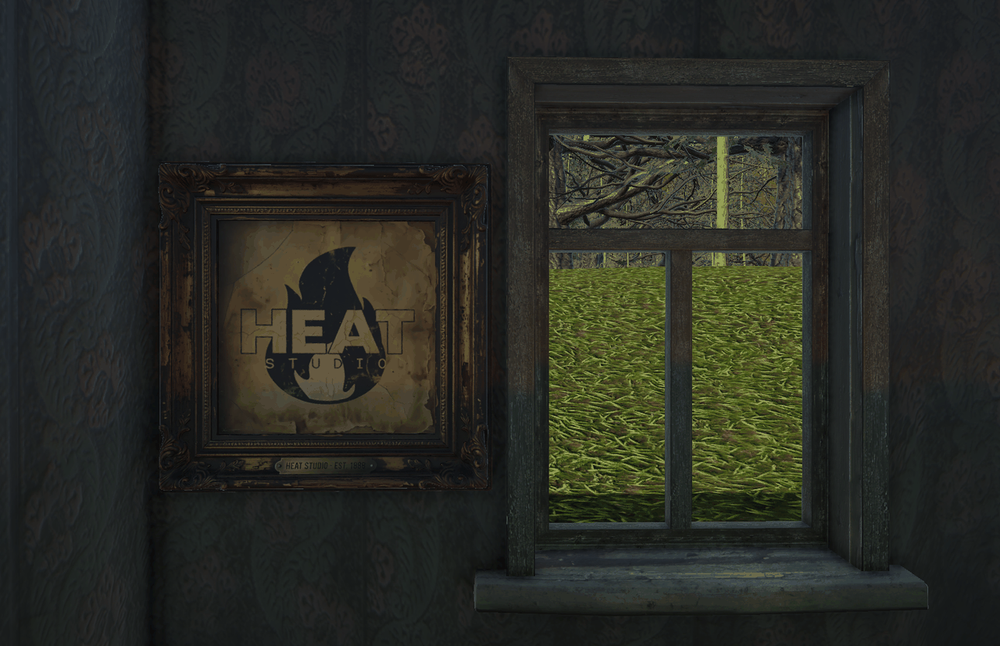
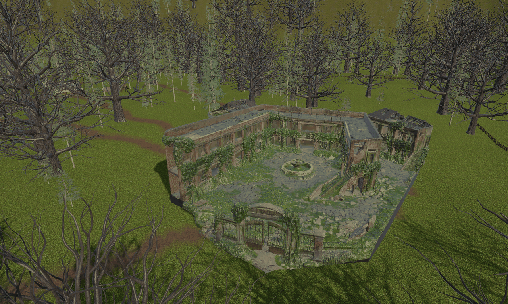
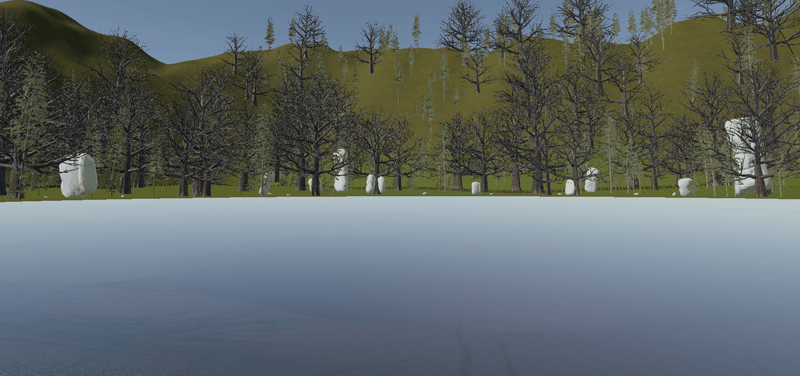

# 🪵 Last Ember (Work In Progress)


> **Last Ember** is a First-Person Survival Horror game developed with **Unity Engine**. Players explore the abandoned Ashfall Nature Reserve, survive within an eerie dark forest environment, manage vital light sources, inspect clues, and evade mysterious shadow entities.

---

## 📸 In-Game Screenshots & Environment (Preview)

> 💡 *The project is currently in active development (Work In Progress / Alpha Build).*

### 🗺️ Map Overview & Key Landmarks

| Ashfall Nature Reserve Entrance | Aerial Map Overview & Lake |
| :---: | :---: |
|  |  |
| *Entrance to Ashfall Nature Reserve* | *Aerial overview of valley, lake, and terrain* |

---

### ⛺ Survival Environment & Campsites

| Abandoned Bus & Campsite | Lakeside Campfire & Cooking Pot |
| :---: | :---: |
|  |  |
| *Rusty abandoned bus and camping tents* | *Lifesaving campfire setup by the lake* |

---

### 🏚️ Cabins & Ancient Ruins

| Abandoned Wooden Cabin | Cabin Interior & Window View |
| :---: | :---: |
|  |  |
| *Mysterious abandoned wooden cabin* | *Interior view with wall frame & forest window* |

| Overgrown Ancient Courtyard Ruins | Lakeside Panorama & Forest |
| :---: | :---: |
|  |  |
| *Overgrown ancient ruined mansion with fountain* | *Atmospheric lake view and dense foliage* |


---

## ✨ Key Features

- 🌲 **Ashfall Nature Reserve World:** Expansive open map featuring campsites, abandoned cabins, rusty buses, and ancient overgrown ruins.
- 🕯️ **Light Management & Survival Mechanics:** Campfires, flashlights, and lanterns with realistic flickering effects (`LightFlicker.cs`) to ward off darkness.
- 🌙 **Dynamic Day-Night Cycle:** Real-time environmental shift between day and night (`DayNightCycle.cs`) influencing threat levels.
- 👹 **Monster AI & Shadow Figures:** Intelligent monster pathfinding (`MonsterAI.cs`) and eerie stalking entities (`ShadowFigure.cs`).
- 🔍 **Interactive Environment:** Object inspection system (`InspectableObject.cs`), interactable trunks/chests (`InteractableTrunk.cs`), and door mechanisms.
- 🌿 **Custom Shaders & Foliage:** Custom wind-blown grass shader (`GrassWindShader.shader`) and terrain blending (`ForestTerrainBlend.shader`).

---

## 🎮 Controls

| Action | Input (Keyboard + Mouse) |
| :--- | :--- |
| **Move** | `W` `A` `S` `D` |
| **Look Around** | Mouse Movement |
| **Sprint** | Left `Shift` |
| **Toggle Flashlight** | `F` |
| **Interact / Open Door / Trunk** | `E` |
| **Inspect Item** | Left Mouse Button / `E` |
| **Pause Game** | `Esc` |

---

## 🛠️ Tech Stack

- **Engine:** Unity Engine 2022.3 LTS (Universal Render Pipeline - URP)
- **Language:** C#
- **Input:** Unity Input System / Custom First-Person Controller
- **Shaders:** HLSL / Custom Shader Graph

---

## 🚀 Getting Started & Installation

### Prerequisites
- Unity **2022.3 LTS** or newer.
- Git & Git LFS.

### Installation Steps

1. **Clone the repository:**
   ```bash
   git clone https://github.com/MinhPhuc00ne/Last-Ember.git
   cd Last-Ember
   ```

2. **Open with Unity Hub:**
   - Launch **Unity Hub** -> Click **Add** -> **Add project from disk**.
   - Select the `Last-Ember` project directory.

3. **Run in Unity Editor:**
   - Open the main scene located in `Assets/_Project/Scenes/`.
   - Click ▶️ **Play** to test the game.

---

## 🗺️ Development Roadmap

- [x] First-Person Controller & movement mechanics
- [x] Ashfall Reserve map, wooden cabin & ancient ruins
- [x] Dynamic Day/Night Cycle & Flashlight system
- [x] Custom vegetation & terrain shaders
- [x] Basic Monster AI & Shadow Figure mechanics
- [ ] Complete quest & narrative progression system
- [ ] Performance optimization & Spatial Audio integration
- [ ] Public Alpha Demo Release

---

## 🤝 Contributing

Contributions to **Last Ember** are welcome! Please read our [CONTRIBUTING.md](file:///d:/GameProject/Last-Ember/CONTRIBUTING.md) guide for branch naming conventions and Conventional Commits standards.

---

## 📄 License

Distributed under the **MIT License**. See [LICENSE](file:///d:/GameProject/Last-Ember/LICENSE) for more information.
